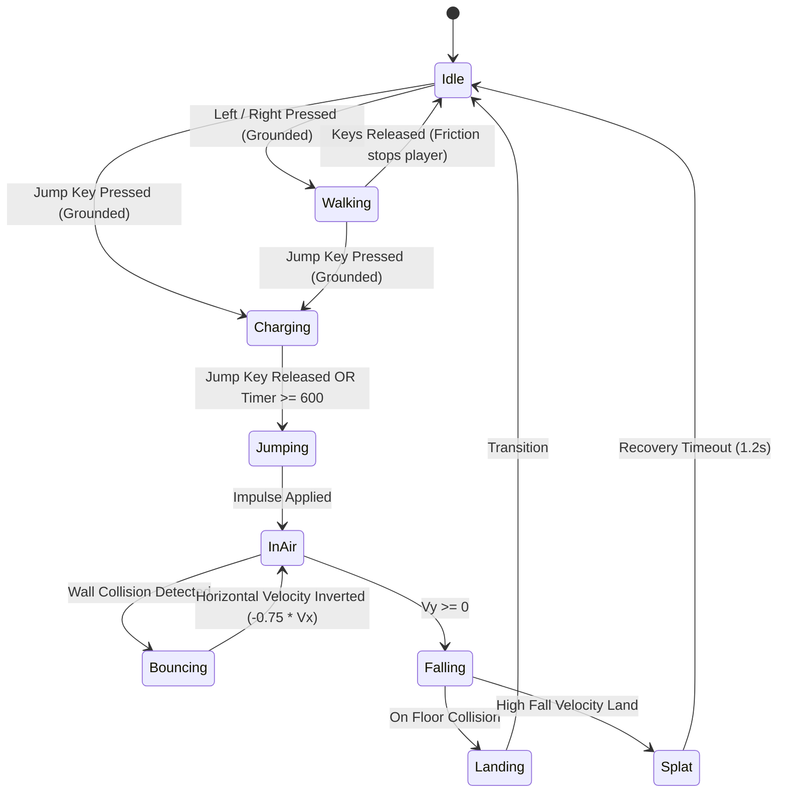

# Gameplay Mechanics Specification: Jump King Browser

**Reference**: https://s4c2.itch.io/jump-king-browser  
**Status**: Verified from decompiled Construct 3 event sheet `Emain`  

---

## 1. Core Player State Machine

The player character (`pla`) operates on an 8-state discrete finite state machine:

### 1.1 State Table & Behaviors

| State | Input Enabled | Sprite Animation | Physics Condition | Audio Trigger |
| :--- | :--- | :--- | :--- | :--- |
| **Idle** | Walk, Jump | `1` (1 frame, idle pose) | Grounded, $V_x \approx 0$ | None |
| **Walking** | Walk, Jump | `2` (3 frames, walk cycle) | Grounded, $\|V_x\| \le 150\text{ px/s}$ | None |
| **Charging** | Directional hold | `5` (1 frame, crouch pose) | Grounded, locked $V_x = 0$ | None |
| **Jumping** | None (locked) | `3` (1 frame, upward reach) | $V_y < 0$ | `king_jump` |
| **InAir / Fall**| None (locked) | `4` (1 frame, falling tuck) | $V_y > 0$ | None |
| **Bouncing** | None | `6` (splat/stun flash) | Raycast wall hit | `king_bump` |
| **Landing** | Walk, Jump | `1` | Transition to grounded | `king_land` |
| **Splat** | Locked | `6` (ground splat) | High fall velocity ($V_y > 450$) | `king_splat` |

---

## 2. Input Mechanics

### 2.1 Desktop Controls
- **Walk Left**: Arrow Left (`Key 37`) or `Key A` (`Key 65`).
- **Walk Right**: Arrow Right (`Key 39`) or `Key D` (`Key 68`).
- **Jump / Charge**: Spacebar (`Key 32`).

### 2.2 Mobile Touch Controls
- Virtual button overlays located in HUD layer:
  - `buttonleft` (Object index 29): Walk left.
  - `buttonright` (Object index 30): Walk right.
  - `buttonjump` (Object index 31): Charge and execute jump.

### 2.3 Input Discipline & Air Control
- **Zero Air Steering**: Once the player leaves the ground, all horizontal directional inputs are completely ignored until landing.
- **Fixed Trajectory**: The jump angle is determined strictly at the moment of release.
  - If Left is held: Jump left diagonal.
  - If Right is held: Jump right diagonal.
  - If neutral: Jump straight up.
- **Charging Lock**: While charging, the player cannot walk. Directional keys held during charging decide jump direction upon release.
- **Auto-Release at Max Charge**: If the player holds the jump key continuously, the jump forces execution immediately upon hitting $600\text{ ms}$ charge counter ($480\text{ ms}$ real-time).
